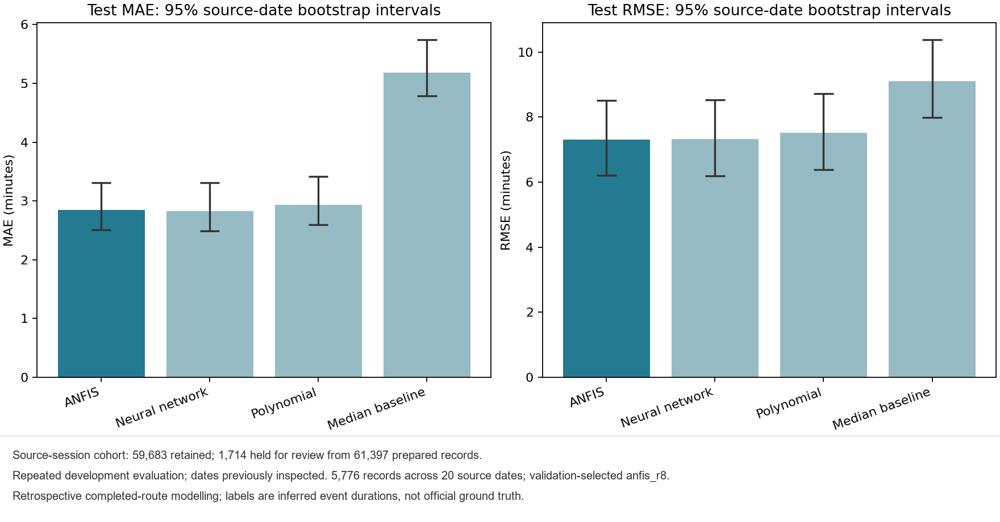
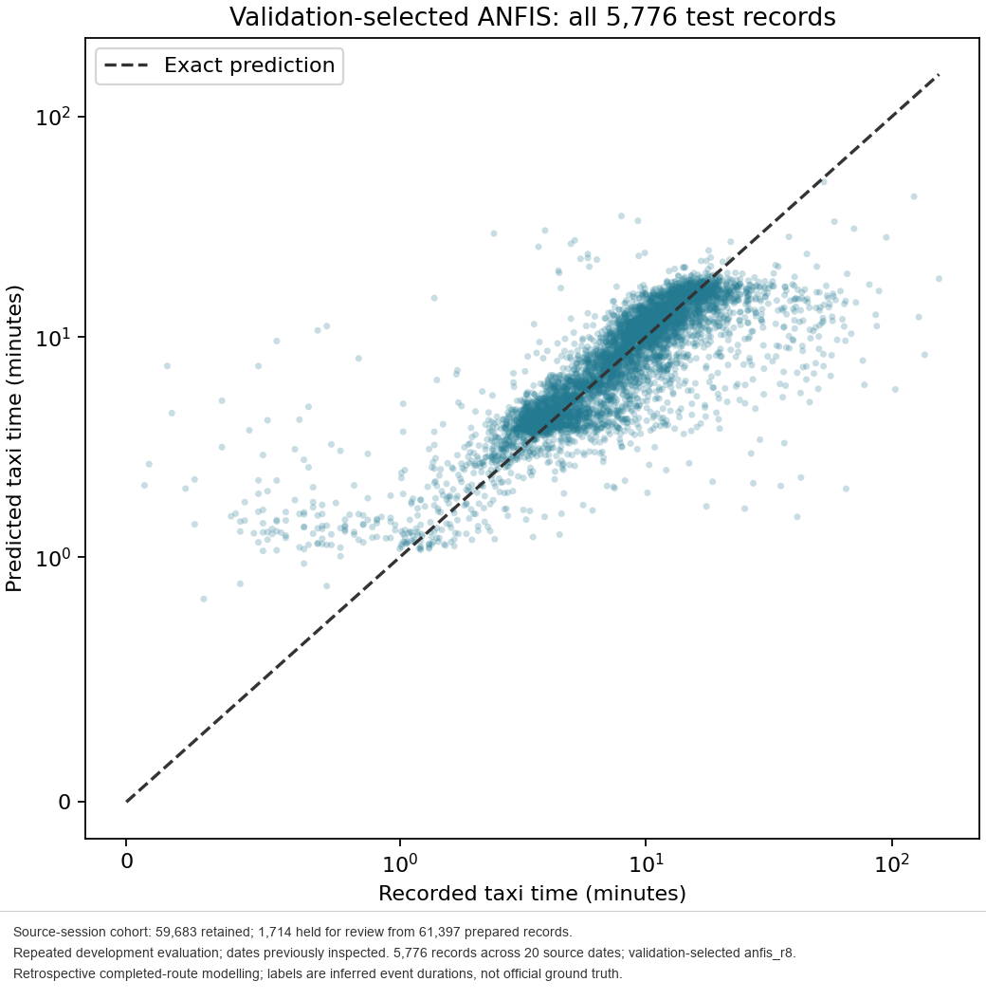

# Manchester Airport Taxi-Time Modelling

A portfolio-focused Python project that builds and evaluates machine-learning models for taxi-time estimates at Manchester Airport. It starts from 12 monthly feature files and combines data checks, source-session validation, PCA-guided feature selection, three model families, chronological evaluation, uncertainty analysis, and an example prediction workflow.

This is a Python portfolio extension of the case study. It uses the supplied 2021 monthly feature data, a custom Python ANFIS implementation, and a chronological evaluation workflow.

> **Scope:** This is retrospective modelling of completed journeys using inferred taxi-time labels and completed-route information. It is not a live taxi-start forecast and does not establish airport-wide or operational accuracy.

## Project highlights

- Built a reproducible workflow from monthly feature CSVs through model comparison and prediction.
- Added aircraft-identity checks and source-session auditing against the supplied cleaned and snapped records.
- Kept PCA, feature selection, scaling, and model selection within the training/validation process.
- Compared polynomial Ridge regression, a back-propagation neural network, and a clustered, trainable ANFIS against a median baseline.
- Used chronological, whole-date splits and a one-day boundary gap.
- Added paired source-date bootstrap intervals, saved prediction outputs, 11 captioned figures, and 70 automated tests.

## Problem and approach

The project investigates whether route, movement, time-of-day, and traffic-context features can explain the supplied taxi-time labels. The target is the taxi_time field in minutes. Those labels are inferred by the supplied feature-generation pipeline; they are not independently verified airport ground truth.

The workflow:

1. **Audit the monthly inputs.** Merge the 12 feature files and apply deterministic month ownership, target/type validation, vehicle-ID checks, and aircraft-identity checks. Keep review and exclusion records for traceability.
2. **Check source-session support.** Compare candidate UTC-clock and Europe/London-clock interpretations with the cleaned and snapped observations. Retain records only when the declared source-session rule gives one supported mapping. Preserve the original labels and features; hold unresolved records for review.
3. **Split by time.** Keep complete source-date groups in training, validation, and evaluation partitions, with a boundary gap to reduce adjacent-date leakage.
4. **Select features.** Fit route PCA on training data only. Use a fixed validation probe to choose a compact subset of original factors; final models use these interpretable factors rather than replacing them with principal-component scores.
5. **Train and compare models.** Use the same split and training-fitted preprocessing for polynomial Ridge regression, an MLP neural network, and the custom ANFIS. Select the winning configuration on validation performance.
6. **Evaluate and predict.** Score the frozen validation-selected model and comparators, calculate uncertainty intervals by resampling source dates, run the source-quality audit, and create example predictions.

The source-session screen is a declared consistency check, not proof that a movement is a real taxi event. The historical computer timezone is unknown, so the project tests two clock interpretations rather than silently choosing one.

## Dataset and split

| Stage | Records |
| --- | ---: |
| Monthly feature rows | 63,842 |
| Prepared after calendar, target/type, vehicle, and identity rules | 61,397 |
| Supported by the declared source-session audit | 59,683 |
| Held for source review | 1,714 |
| Training | 41,725 |
| Validation | 11,640 |
| Repeated evaluation | 5,776 |
| Boundary gap | 542 |

The chronological partitions are:

- Training: 1 January–27 October 2021
- Validation: 29 October–10 December 2021
- Evaluation: 12–31 December 2021

The December dates were inspected in an earlier development run. Results below are therefore **repeated development evaluation**, not fresh independent test evidence.

## Feature selection and models

Training-only PCA retained **3 route components**, accounting for **95.11%** of route-feature variance. Validation selected eight original factors:

type, start_hour, n_departing_at_start, n_arriving_at_start, angle, shortest path, distance_gate, and distance_long.

Cyclic encoding of start_hour produces nine numeric model inputs. PCA is used to understand route variation and guide feature selection; the final models use the selected original factors.

| Model | Validation MAE (min) | Evaluation MAE (min) | Evaluation RMSE (min) | Evaluation R² | Evaluation MRE |
| --- | ---: | ---: | ---: | ---: | ---: |
| ANFIS, 8 rules (selected on validation) | 2.6490 | 2.8433 | 7.3054 | 0.3138 | 30.80% |
| Neural network, 16 hidden units | 2.6552 | 2.8239 | 7.3170 | 0.3117 | 30.10% |
| Polynomial Ridge | 2.7524 | 2.9310 | 7.5199 | 0.2730 | 31.26% |
| Training-median baseline | 5.0400 | 5.1791 | 9.1082 | -0.0666 | 90.20% |

ANFIS remains the reported winner because it had the lowest validation MAE. The neural network's MAE is slightly lower on the already inspected December records. The paired whole-date bootstrap interval for ANFIS minus neural-network MAE is **-0.027 to 0.083 minutes**, which includes zero; these data do not establish a meaningful difference between the two models. Both have lower MAE than the median baseline on this screened cohort.

MRE is included for completeness but is sensitive to short-duration labels. MAE and RMSE are the primary error summaries. RMSE notably exceeds MAE, reflecting a tail of longer errors, and the moderate R² values show there is substantial unexplained variation.

## Results and figures

The saved evaluation contains predictions for all 5,776 records for each model. Reported MAE and RMSE were independently recomputed from the saved prediction CSV and matched the stored metrics. The export manifest verifies the source and digest of each of the 11 captioned figures.





Additional PCA, feature-selection, training, residual, and error-distribution figures are in the publication_figures/final-run folder.

## Example prediction

The repository includes a small, non-sensitive example input. After running the full workflow, generate predictions with:

```powershell
.\.venv\Scripts\python.exe -B src\predict.py `
  --model-dir artifacts\runs\final-run\step04 `
  --input examples\prediction_input.csv `
  --output artifacts\runs\final-run\predictions\example_predictions.csv `
  --support-profile artifacts\runs\final-run\step06\training_support.json
```

The prediction metadata records the selected model, input/output digests, target units, and basic training-range checks. A numerically valid prediction is not a calibrated confidence estimate or evidence of live operational accuracy.

## Reproduce the workflow

Use Python 3.11 on Windows. Keep the supplied data and executable tools in local folders; they are not included in the public repository.

```powershell
python -m venv .venv
.\.venv\Scripts\python.exe -m pip install -r requirements.txt
.\.venv\Scripts\python.exe -m unittest discover -s tests -v
```

Run all stages from the repository root:

```powershell
.\scripts\run_full_project.ps1 `
  -FeatureDataDir ".\Feature data" `
  -CleanedDataDir ".\Cleaned data" `
  -SnappedDataDir ".\Snapped data" `
  -ProgramsDir ".\Programs" `
  -PythonExecutable ".\.venv\Scripts\python.exe" `
  -RunName "final-run"
```

The workflow stops rather than overwriting an existing run. Results go under artifacts/runs/final-run; captioned figures and their digest manifest go under publication_figures/final-run. The project also exposes each stage as a separate program under src/. The synthetic demo runs a small example; its scores are software checks, not evidence about airport performance.

## Tests

Run the 70-test suite with:

```powershell
.\.venv\Scripts\python.exe -m unittest discover -s tests -v
```

The tests cover data policies, identity auditing, chronological splits, PCA and feature handling, model training, ANFIS behavior, evaluation, prediction, uncertainty intervals, and source-session support. Passing tests checks software behavior; it does not validate the inferred labels as ground truth.

## Repository contents

- src/: preparation, source auditing, PCA/feature selection, model training, evaluation, diagnostics, prediction, and figure export.
- scripts/run_full_project.ps1: one-command Windows workflow.
- tests/: automated tests.
- examples/: example prediction input.
- publication_figures/final-run/: captioned figures and export manifest.
- benchmarks/recorded_results.json: aggregate metrics and evaluation qualifiers.
- QUALITY_NOTES.md and INTERVIEW_NOTES.md: label, metric, and implementation details.

Raw university data, executable tools, generated model objects, row-level predictions, and the local virtual environment are excluded from Git. The project does not require MATLAB for its Python ANFIS implementation.

## Limitations and responsible interpretation

- Taxi-time targets are inferred from the supplied feature-generation process; no official event ground truth was provided.
- The timezone used by the original data-collection computer is unknown. The audit retains its explicit UTC and Europe/London hypotheses.
- A supported observation session is source consistency under the declared rules, not independent confirmation of taxi movement.
- The evaluation dates were previously inspected during development; they must not be presented as an untouched test set.
- Inputs describe completed routes. This is retrospective modelling, not an operational forecast available at taxi start.
- The cohort is screened and the evaluation covers 20 December dates. Results may not generalize to all records, years, airports, or operating conditions.
- No model in this repository is safety-certified or ready for operational air-traffic-management use.

